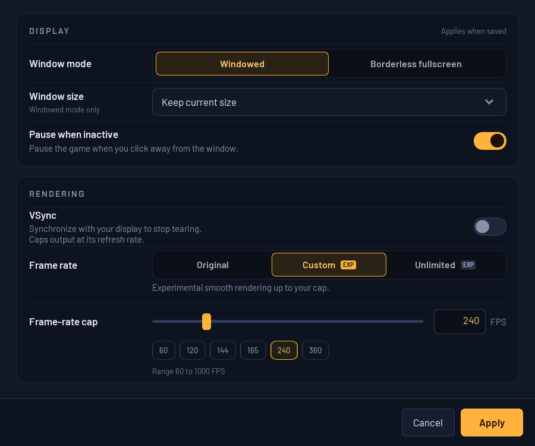

# Experimental high-refresh rendering

Version 1.2.0 includes opt-in high-refresh rendering and native RmlUi Video
Settings. Gameplay timing remains independent of presentation. Tested semantic
ownership, audio and performance corrections are included; owner playtesting
reports stable gameplay and resolved reported shuriken/crouch defects. Unlimited,
all-route no-dip performance, shadow cadence and the reported exit-cutscene audio
interruption remain subject to the [current limits](../known-issues.md).

The chronological entries below preserve the evidence and intermediate failures;
earlier statements that a candidate was not released describe that stage.

## Try it

Open **Video > Video settings...** in the launcher. This is an owned Windows
window rendered with RmlUi, using the supplied dark-panel design, keyboard
navigation and Apply / Cancel. It shares the launcher's embedded fonts and
rendering backend. It opens centered over the launcher at the owner's DPI,
with its position limited to the monitor work area so it stays on screen.
The window-size dropdown centers its selected text vertically at desktop scaling.
Small FPS presets use continuous antialiased image borders to avoid patch seams.



| Setting | Behavior |
|---|---|
| Original | Original presentation; default for profiles without video settings |
| Custom | Set 60-1000 FPS with the slider or exact whole-number field; presets 60, 120, 144, 165, 240 and 360 |
| Unlimited | Removes the FPS cap when VSync is off; no hidden numeric target |
| VSync | On synchronizes to the display; Custom is limited to detected refresh, and Unlimited follows refresh |
| Window mode / size | Windowed or borderless fullscreen; current size, 1280 x 720, 1600 x 900, 1920 x 1080 or 2560 x 1440 |
| Pause when inactive | Pause when the launcher loses focus |

Apply saves and closes; Cancel discards edits. The native Windows title bar
is the only title bar. Load/save errors appear in the content only when needed. **Rendering changes apply on the next game launch.** Window and
pause preferences apply immediately when saved. This means stopping and starting
the game, not restarting Windows or the launcher. The restart chip is hidden when
no game is running. The original game controls aspect ratio; Borderless fullscreen
is the supported fullscreen mode.
Opening this dialog during gameplay requests the existing cooperative pause;
closing it releases that request. VSync off permits tearing. A Custom FPS value
is a target/cap, not a guarantee that every scene can reach it.

The profile's `video.ini` stores `version=1`, `mode=original|custom|unlimited`,
`fps=60..1000` and `vsync=0|1`, one key per line. The custom number is remembered
when switching modes. Missing configuration defaults to Original, 60, VSync on;
malformed or unreadable configuration is reported. Navigation-mod launches share
the main profile's video choices.

The machine-local complete preview is
`C:\JFG-builds\high-refresh-native-timing-preview-20261012`. Its
`Play-Video-Settings.cmd` and desktop **JFG - High Refresh Preview** shortcut reuse
the earlier isolated high-refresh preview profile, preserving its saves and video
preferences (initially Custom 60 / VSync on). Close the currently running launcher first: the production launcher
allows one instance per Windows session. Progress in the copied preview profile
stays there. This preview is not an installed update or a published release.

For standalone diagnostics, the [preview helper](../../scripts/play_high_refresh.ps1)
copies saves and selected configuration into a new directory per invocation:

```powershell
.\scripts\play_high_refresh.ps1 -Runtime C:\JFG-build\Release\jfg-native-boot.exe -Rom C:\Games\jfg.z64 -Save C:\Games\jfg.flash -Fps 360 -VSync Off
.\scripts\play_high_refresh.ps1 -Runtime C:\JFG-build\Release\jfg-native-boot.exe -Rom C:\Games\jfg.z64 -Save C:\Games\jfg.flash -Unlimited -VSync Off
```

`-Fps 0` means Original. Use `-ProfileDirectory` for controller, modern-control,
PC-input, audio and video files; `-ControllerPak` optionally copies a pak. Each
invocation starts from the supplied save; the helper prints the new save folder.
Advanced overrides are `JFG_VIDEO_CONFIG=<path>`,
`JFG_EXPERIMENTAL_RENDER_FPS=0|60..1000|unlimited`, and `JFG_RENDER_VSYNC=0|1`.
Normal launcher sessions sanitize inherited diagnostics and forward the profile.

## What was implemented

- Graphics tasks carry immutable guest VI timestamps and previous transform
  snapshots. Unique, unchanged mesh geometry anchors conservative matches. All
  batches sharing one current matrix use the same interpolation or endpoint
  fallback, avoiding cracks when culling changes individual batches.
- Presentation interpolates combined matrices; authored matrices and RT64's
  native-resolution feedback remain unchanged. Count, VI, audio and input
  simulation clocks are not accelerated.
- Shadow-only submissions and ordinary 30/20 Hz cadence changes retain scene
  history. Ambiguous geometry, other irregular cadence, camera-plane crossings
  and large projected motion use endpoints.
- Completed finite sequences repeat their latest image through the paced output
  window. Alternating GPU target banks prevent the next sequence overwriting
  those images, at roughly twice the intermediate-target storage.
- Custom uses a paced target. Unlimited with VSync off samples monotonic time
  within each source-frame window and reuses two synchronized render targets.
  A later VI repeats the latest completed image once, never overwritten history.
- Queued scenes or unknown work preempt Unlimited interpolation; shadow-only
  work waits at most the remaining source-frame window. This scheduling still
  needs broader wall-time and audio-device qualification.

The [DK64 and other port comparison](../upstream/high-refresh-reference-review-2026-10-11.md)
informed the design. No upstream game patches were imported. Dependency patches
apply only to exact hash-checked RT64 build-tree copies; the pinned source stays
unchanged. Original mode remains available.

## RmlUi window and restart verification (2026-10-11)

Implementation commit: `5527611ea10b247dbb2df46ca1870a8d93d365f4`.

The owner's `Child - Video settings-html.zip` design was translated into RML,
RCSS and native C++ events in the existing pinned RmlUi backend. No dependency
upgrade, browser, React runtime or remote font loading is needed. The previous
standard-controls dialog remains a fallback for builds without RmlUi.

The new window passes 101 checks, including real pointer/slider/text input,
presets, invalid values, Apply/Cancel/reopen, failed saves, window-size keyboard
selection, Escape closing the dropdown before the dialog and Tab navigation.
Screenshots were inspected at 100% and 150% layout scaling. The real launcher
fixture at 125% DPI verifies the menu route, owned modal, file persistence,
immediate fullscreen/windowed changes, pause preference and recovery after a
settings-process failure. Live gameplay verifies pause acknowledgment and a
stopped/resumed VI clock. Existing modern-controls (546) and controller-mapping
(207) checks pass. No physical desktop input or owner-window manipulation is used.

Restart behavior was tested against the unchanged renderer binary in three
900-VI runs. Saving VSync off during a 360-target session left its effective target
at the display's 240 Hz; the next game session used 360. Saving 144 during that
session left its target at 360; the next session used 144. Consequently, FPS and
VSync require a new game session. Display settings are applied directly by the
launcher and were verified without restarting the game.

Private evidence and failed attempts are indexed in
[RENDER-001](../development/issues/high-refresh-rendering.md). These tests qualify
the settings window and restart behavior; the rendering limits below still apply.

## Earlier native-controls candidate verification (2026-10-11)

Implementation commit: `b39533a5b3661544d5322bd70cd64ae9843f5254` on
`research/high-refresh-20261011`.

Hardware: RTX 5090, Ryzen 7 5800X, detected 240 Hz display, 640 by 480 output.
Measurements cover only the approximately 1.6-1.74-second moving-camera window
at VI 4000-4098 in isolated 4,100-VI replays. Capture readback runs are separate.

| Mode / VSync | Presents/s | Median / p95 / p99 interval (ms) | Evidence series |
|---|---:|---|---|
| Custom 60 / On | 59.99 | 16.658 / 16.970 / 17.126 | v1; fixed-rate path |
| Custom 360 / Off | 356.74 | 2.780 / 2.983 / 3.538 | v2 |
| Custom 1000 / Off | 644.78 | 1.007 / 3.753 / 11.494 | v3 |
| Unlimited / Off | 1137.31 | 0.575 / 2.503 / 6.788 | v3 |

These are short-scene presentation rates, not sustained whole-game benchmarks
or physical 360 Hz display qualification. The v3 Unlimited replay took 71.515 s
versus Original's 70.109 s (about 2% longer); equal guest execution does not imply
identical wall-time throughput. Unlimited pacing remains uneven. Initial v1
Unlimited throughput was invalidated by completed-ring replay and is excluded.

Compared modes preserve byte-identical 4 MiB guest RAM, 8 MiB renderer snapshots,
recorded input, saves and the entire probe result. All report 1,906 controller
samples, 2,896 graphics tasks, 2,047 decoded audio tasks, 3,680,667,236 instructions
and zero unsupported accesses. This proves fixture equivalence, not audio-device
underrun behavior or full resumable snapshot equivalence.

The final runtime's separate swapchain capture has two sampled groups of four
distinct images, including indices beyond the two-slot ring. Its memory, input,
save and probe still match Original. Sampled HUD, character and reflection are
visible. Seven focused C++ tests, 637 managed launcher checks, 15 setup checks,
six graphics checks and viewport checks passed. Native-control tests cover
validation, slider/edit synchronization, persistence, Apply, Cancel and reopen.
The real frontend and a replay-driven game on an inactive desktop verify the
Video menu route, owned modal, runtime pause acknowledgment, stopped/resumed VI
clock and unchanged source save. Only the fixture launcher singleton differs;
that test executable is not delivered.

See [RENDER-001](../development/issues/high-refresh-rendering.md) for source and
binary receipts, failed attempts and private evidence. The probe deliberately
retains `acceptance=false` and `runtime_snapshot_complete=false`.

## Historical first candidate (before native controls)

Implementation source: local commit `8d8f09701cc50d3a5b03eafd90ff5a41d3aeb3e9`.

Hardware: RTX 5090, Ryzen 7 5800X, RT64-detected 240 Hz display; captured output
640 by 480. Three identical-input replays ended at VI 4100 in 70.16-70.33 seconds.
The original, 60-target and 360-target runs have byte-identical 4 MiB guest RAM,
8 MiB renderer snapshots, recorded input and saves, plus the same probe state hash.
Instruction, controller-sample, graphics-task and decoded-audio-task counts also
agree. This does not establish audio-device underrun behavior or full resumable
snapshot equivalence.

| Requested FPS | Effective target | Camera-window presents/s | Median / p95 / p99 interval (ms) |
|---:|---:|---:|---|
| 60 | 60 | 59.98 | 16.672 / 16.738 / 16.755 |
| 360 | 240 | 239.81 | 4.170 / 4.303 / 4.411 |

Rates and interval percentiles cover the approximately 1.6-second moving-camera
window at VI 4000-4098, excluding screenshot readback. That window rendered two
or eight presentation states per authored 30 Hz scene. The full replays include
loading and static/menu sections; these numbers are not a whole-game benchmark.

The 60 and 360 requested modes respectively logged 1,344 and 9,357 intermediate
frames with changing matched transforms. Separate bounded screenshot replays
capture actual swapchain images from the same presentation group, verify distinct
pixels and retain matching guest RAM. The sampled HUD, character and reflection
are visible; this is not acceptance of all overlays or scenes.

Release build and five focused tests pass: interpolation history, RT64 matrix
adapter, shell/memory, F3DDKR texture handling and depth bounds. The probe retains
`acceptance=false` and `runtime_snapshot_complete=false`, accurately reflecting
its limited coverage. See [RENDER-001](../development/issues/high-refresh-rendering.md)
for attempts, hashes and private evidence locations.

## Remaining visual and performance work

Exact geometry matching is a conservative prototype, not semantic actor identity.
Repeated models, changing topology and some animation/effects use endpoints.
Actor reuse, small camera cuts, fast rotations, changing viewports, cutscenes,
menus and multiplayer need explicit coverage. Simple coefficient interpolation
is not rotation decomposition and can distort some motion. The native-dialog
pause path is verified; this does not cover all transition and pause paths.

SkipBuffering can display a scene before a CPU-composited overlay is applied.
The sampled HUD remains visible, but general CPU-overlay ownership is unqualified.
Mixed scene/offscreen workloads, resize, multi-monitor DPI/refresh changes and
loading transitions also need testing.

Longer frame-time runs, GPU timings, memory growth, 360+ Hz output hardware,
audio-device behavior and owner playtesting remain open. Interpolation does not
repair the separate [combat simulation-cadence issue](../development/issues/goldwood-combat-slowdown.md).

## Diagnostics

`JFG_RT64_INTERPOLATION_TRACE` writes TSV rows with event, steady-clock
microseconds, guest VI tick (render) or present ID (present), source rate,
effective target, frame index/count, interpolation weight and matched/moving
transform counts. Unlimited target/count is represented as zero in the trace.
Extra presentation calls alone are not evidence of extra motion.

For image qualification, create an empty directory and set
`JFG_RT64_FRAME_SEQUENCE` to it plus `JFG_RT64_CAPTURE_FROM` to a present ID
from the trace. This captures at most four present IDs and sixteen frames per ID
as PPM files. GPU readback disturbs pacing; do not benchmark a capture run.

Keep the production guard enabled and retain the existing
`high-refresh-rendering-20261011` ledger lineage for autonomous continuation.

## Shared-transform preview delivery (2026-10-11)

Runtime implementation `dbc4c91f487a5a1b064ed55a49d60fa40dc536e7` corrects the reproduced
Goldwood high-refresh terrain cracks. The desktop preview uses the complete
`high-refresh-coherent-preview-20261011` package and retains the same profile.
Five focused renderer tests and four clean muted replay modes pass; the short
walking sample measured about 60 FPS at the 60 cap, 355 FPS at the 360 cap, and
1247 FPS uncapped. These are bounded replay observations, not sustained gameplay
guarantees. The longer outward/return lighting checks preserve native game state
between Original and Custom. Lighting code is unchanged; the intermittent
return-direction delay and Original-mode joint report remain open in
[RENDER-002](../development/issues/character-seams-lighting.md).


### 2026-10-12 character follow-up

The reported thin thigh gaps remain open. Original and Custom 360/VSync preserve
the same final game state in the modern-control replay. Dense geometry checks
show the connected body held at the original animation pose in 215 observed
frames, without separating shared vertices. Thus the current high output rate
does not imply fully interpolated skin animation. This bounded result does not
establish raster coverage parity or resolve the owner's exact pose. No new
character fix or package was delivered; see the [issue's dense follow-up](../development/issues/character-seams-lighting.md#dense-thigh-follow-up-2026-10-12)
and [aggregate evidence](../../evidence/high-refresh-character-seams-investigation.json).


### FPS counter and slowdown logs

The upper-right counter shows **OUTPUT** (including generated/repeated images),
**SCENES** (new screen-scene submissions), mean **MS** and worst **MAX** interval.
High-refresh output explicitly says **INTERPOLATED / REPEATED**. Neither rate
measures physical monitor scanout or simulation ticks. Source scenes also drop
to 20 Hz in the pre-logging build; 120 outputs do not mean 120 unique game poses.

**F8** toggles the counter and CSV recording while the game has focus. Diagnostics
start enabled in this preview. For logging without drawing, add `overlay=0` to
`performance.ini` beside `video.ini` and restart the game. Removing it restores
the counter. Stop the game after reproducing a slowdown, then open the desktop
**JFG - Performance Logs** shortcut and share the newest session's CSV files.
The bounded background writer retains four rotating 16 MiB segments per session;
previous sessions stay until removed by the owner.

The revised counter draws one cached texture. The renderer also corrects
completed-sequence rewinds and interpolation dropouts at normal 30/20 Hz changes.
Muted 120/360 capped tests improve frame pacing while retaining original game
progression. Original, VSync, Unlimited, log-only and maximum-cap checks are
recorded in [PERF-002](../development/issues/frame-diagnostics.md). Unlimited can
still reduce source-scene throughput slightly under saturation; high output FPS
alone does not qualify it. Current desktop VSync is tested at detected 60 Hz.
Owner confirmation of the reported stutter is pending, as are broader scenes,
complete actor interpolation and the separate joints/lighting reports.


### Native scene timing preview (2026-10-12)

The private runtime enables JFG_EXPERIMENTAL_NATIVE_PLAY_TIMING=ON. The measured
Goldwood bridge holds about 30 new scenes/s in capped play instead of falling to
20 from modeled CPU penalties. Guest update steps, movement scaling and saves
are unchanged. Other builds default to the original clock; finite reference
probes retain it unless explicitly overridden for diagnostics.

Counter/CSV schema 2 samples successful presentation after pacing. Use Custom for
current testing: Unlimited can still hold up game work and lower scene cadence.
Its reproduced transition hang is fixed by a bounded ring wait. Normal bridge/
pause testing records zero audio underruns; longer native startup testing records
three, so audio quality/loading continuity still need owner verification. Heavy
screenshot diagnostics can stall the GPU; use lightweight F8 logs for performance
reports. See [PERF-002](../development/issues/frame-diagnostics.md).


Delivered locally as `high-refresh-native-timing-preview-20261012`, through the
existing **JFG - High Refresh Preview** desktop shortcut and unchanged profile.
Close an older launcher before reopening the shortcut. The committed runtime
averages 119.66 output FPS / 29.76 scenes/s with Custom 120 and requested VSync,
and 351.99 output FPS / 29.78 scenes/s with Custom 360 and VSync off, in the
bounded moving bridge window. These muted hidden-window checks do not verify
physical monitor scanout or resolve the heavier combat report. Source commit,
runtime hash, exact checks and remaining limitations are in
[qualification](../../evidence/native-scene-timing.json). Owner testing remains
pending; use F8 lightweight logging when reporting issues.


Owner follow-up: steady 120/30 still feels jittery, especially during simultaneous
movement and camera rotation. Stable counters do not qualify complete visual
interpolation. Explicit actor/joint/camera identities and synchronized visual
sampling are the requested next target; [RENDER-003](../development/issues/steady-fps-jitter.md)
tracks the report and verification.


### Semantic character and camera interpolation preview (2026-10-13 UTC)

Animated models now carry actor lifetime, instance/model, joint, logical vertex
and camera identities through each copied graphics task. Character vertices
interpolate their world-space endpoints before the shared camera sample. UV
duplicates keep their logical identity; invalid or discontinuous samples hold
the whole actor at its endpoint. Unknown paths retain conservative matching.
Simulation/input speed is unchanged. This is not yet a local skeletal hierarchy
with quaternion blending or per-render camera input.

Seven focused tests, actual-frame captures and bounded muted routes qualify the
candidate scope; [RENDER-003](../development/issues/steady-fps-jitter.md) and the
[evidence](../../evidence/semantic-interpolation.json) record exact results.
Combined camera/movement still triggers an existing 31-update recovery episode
in both old/new runtimes (~27.5 scenes/s over that window). A 360 target averaged
~350 output FPS with an outlier. Physical display smoothness, full animation/
effects coverage and owner acceptance remain open; counters alone are insufficient.


Delivered through the existing **JFG - High Refresh Preview** desktop shortcut as
`high-refresh-semantic-20261013` on D:, with the existing profile/save unchanged.
Close an older launcher before reopening it. The implementation commit, runtime
identity, final checks and unresolved limits are in the linked qualification.
Owner live confirmation is pending; this is a local preview, not a release.


### Capped presentation pacing correction (2026-10-13 UTC)

The owner confirmed the semantic preview's thigh seams and delayed lighting
were absent at 120 FPS, but stationary camera rotation still jumped while the
counter stayed at 120/30. The renderer was repeating consumed interpolation
windows, and capped sequences could be truncated by queued shadow passes.
The corrected queue preserves a scene's intermediate images and acknowledges
redundant VI events without replaying its endpoint for another window.

A 419-degree camera turn yields 1,702 strictly advancing output samples with no
repeated or backward phases. Actual image captures, capped/Unlimited/Original
replays, pause/resume and exact reference-state comparison are recorded in
[pacing qualification](../../evidence/presentation-pacing.json). Physical display
and owner visual confirmation remain pending; original simulation/input timing
and broader high-load limitations are unchanged.


The pacing correction is now delivered through **JFG - High Refresh Preview**
as `high-refresh-pacing-20261013` on D:, preserving the existing profile and save.
Implementation `b9c1aeee7d259f358a5a76ac22b9ba6c9b7644d6`; exact runtime identity and
checks are in the linked qualification. Close the old game/launcher before
reopening. Owner review is pending; this is not a public release.

### Goldwood actors and camera-edge visibility correction (2026-10-13 UTC)

Reduced-detail enemy geometry can now share its actor's full-model bone palette
without losing interpolation. Gem billboard transforms carry actor lifetime,
asset and camera identities. Interpolated main-target geometry is clipped by the
GPU at the displayed pose, preventing the endpoint camera from dropping visible
screen-edge triangles prematurely. Original/offscreen clipping and simulation
timing are preserved.

Actual distant-drone/gem captures advance between source poses and reach the same
endpoints; edge captures restore early-frame pixels with unchanged endpoints.
Nine focused suites, exact Original-state checks and paired Custom non-framebuffer
state checks pass. The final normal 360-cap moving window averages 351.68 FPS /
29.77 scenes/s with no audio underruns; this is not sustained-360 or physical-display
acceptance. See [RENDER-004](../development/issues/actor-jitter-edge-culling.md)
and [qualification](../../evidence/actor-visibility.json). Owner live acceptance,
full-game/effects coverage, authored texture cadence and the existing adaptive
source-rate/Unlimited limits remain.

Delivered locally as `high-refresh-visibility-20261013` on D: through
**JFG - High Refresh Preview**, with the existing profile and save preserved.
Implementation `c9189c1d1d2e356f53a9801c283a527620f71b9b`; all 14 package files
and isolated launcher initialization verify. Close an older game/launcher before
reopening the shortcut. Owner live acceptance remains pending; no public release.


### Combat recovery and pickup-particle candidate (2026-10-13 UTC)

Native play can leave the historical 20-Hz hold on its next measured fast frame;
actual elapsed VI time and real overload remain intact. Pool particle allocation
and retirement provide explicit billboard lifetimes. Known sprite transforms
remain associated through local size animation while retaining asset, camera
and topology checks. Unknown paths still use conservative matching.

Nine focused suites, exact Original-state comparison, pause/resume, overload and
muted copied-save replays qualify the bounded candidate. Combat is still partial
and owner particle verification remains pending. Texture/local-quad animation
keeps its authored cadence. See [qualification](../../evidence/combat-particles.json),
[PERF-001](../development/issues/goldwood-combat-slowdown.md) and
[RENDER-005](../development/issues/pickup-particle-desync.md). No public release.


## Delivery held for performance verification

The implementation is ready for review, but the desktop shortcut and installed
visibility preview remain unchanged. Final combat has real drops and 8/62 audio
underruns at 120/360; late concurrent-runtime load prevents clean attribution.
The post-pause trace has 988 samples, no repeats/rewinds, and three skipped phase
steps. Functional/state/pixel verification does not establish smooth performance.
Do not replace the working preview or call combat fixed until a controlled
single-runtime comparison resolves this. Both candidate sources and all evidence
are preserved. The next bounded run should first coordinate exclusive runtime
testing, compare unchanged/candidate builds on the same copied checkpoint, then
profile remaining host execution/renderer costs if genuine drops persist.

Implementation commit: 83cd8af0bad951d27939adadb74f374840d1303d. The committed build retains
qualified runtime 14746717614559b93fa535f9caf0a02fce50f23d2df3ab23aa6e9302607f30aa.
A copy is retained in the private D: evidence directory. Desktop delivery is
held pending the controlled performance comparison above; no release was made.

### Native CPU bookkeeping candidate (2026-10-13 UTC)

The native timing path caches instruction eligibility and groups up to 16 safe
operations between existing clock/device checks. Actual game operations and
the 128-instruction sampling quantum remain unchanged. Ten focused suites,
compiled RAM/MMIO comparisons, exact Original/native clock-state parity and
pause/overload checks qualify its behavior. Combat performance and delivery
are pending exclusive runtime access. The existing desktop preview remains.
See [PERF-001](../development/issues/goldwood-combat-slowdown.md) for build
compatibility, failed attempts and [evidence](../../evidence/combat-native-spans.json).

### Qualified native combat preview delivered

The controlled 120/VSync repeats maintained 29.75-29.84 SCENES/s and roughly
120 OUTPUT/s. The 360/no-VSync repeat maintained 29.68-29.81 SCENES/s and
352.77-359.55 OUTPUT/s. All three had zero audio underruns. Rare single late
updates remain; this is bounded replay qualification, not physical-display or
full-game acceptance. The earlier holds above are historical and superseded.

The high-refresh-combat-spans-20261013 package is now linked by **JFG - High Refresh Preview**.
It includes CPU spans, faster native 20-Hz recovery and particle lifetimes.
Save/settings are preserved; all 14 manifest files and isolated launcher init
verify. Implementation a93faa5ef61b86536327ffa83d48fc95835a21ff. Owner live review remains.
See [PERF-001](../development/issues/goldwood-combat-slowdown.md) and
[qualification](../../evidence/combat-native-spans.json) for failed comparisons,
measurements and compatibility. No public release.

### Owner full tutorial review (2026-10-13 UTC)

The delivered combat-spans preview remains incomplete for the full tutorial.
The owner's log-only 120/VSync capture shows about 20 scene submissions/s over
7:15-7:35, and 22-25 over 10:45-10:55 despite roughly 115-116 output FPS in
the latter section. Crates, an exit light and a bridge jitter near the later
cave/bridge area. No exact object-to-timestamp mapping or interpolation trace
was captured, so visual and timing causes must not be conflated. This was a
review of existing evidence, not a new experiment or runtime change. See
[RENDER-006](../development/issues/tutorial-late-object-jitter.md) and its
aggregate timing evidence. Earlier bounded passes remain scoped to their fixtures.

## Develop integration (2026-10-13, qualification pending)

Owner requested merging develop `63e49a7a71c3a914d2adc1d91fdcf00bef30d38e`
into high-refresh checkpoint `60cb549bceb023d416dc7721793e809d33ac0699`.
The merge preserves the high-refresh recovery policy, semantic/rigid identities,
video dialog and render diagnostics alongside develop camera, controls, native
audio sample source, profiling and render-viewport fixes. The newer diagnostic
clock-stall environment name accepts the previous high-refresh name as a fallback;
existing high-refresh trace event names remain stable. Both issue histories are
retained. Build and replay results must be recorded before delivery; a successful
merge alone does not establish late-cave or full-tutorial acceptance.

## Develop integration qualified (2026-10-13)

The current candidate incorporates develop camera, controls, audio and widescreen
changes. Build, UI, state replay, muted 120/360 combat, circle and pond checks
pass; a demonstrated video/viewport message collision is corrected.
See [qualification](../../evidence/high-refresh-develop-merge.json) and
[remaining late-tutorial report](../development/issues/tutorial-late-object-jitter.md).
Full-route visual acceptance remains open.

## Local merged-preview delivery (2026-10-13)

The qualified combined runtime/launcher is delivered as
`high-refresh-develop-merged-20261013`. The existing desktop **JFG - High Refresh
Preview** shortcut now selects it; close and reopen an older launcher to use
the new package. Existing save, video/audio/control settings and log-only
performance preferences are preserved byte-for-byte. Package validation and
isolated setup initialization pass. Source merge: `f70b513c896df107163f2d72abed344a87dc2517`.
Runtime SHA-256: `1381e018fa2ec2cc8cc0e9c64c785753485b4068a81a08b7f29f8ca0cee2e4f8`.

This is a local preview, not a public release. Full-tutorial performance and
the exact later-cave crates/exit-light/bridge jitter still require live coverage;
their issue records remain open. All runtime tests were muted. Large private
evidence and the new package stay on D:. The production guard remained enabled
under the same investigation and counters throughout.

## Expanded route review (2026-10-13)

A completed CPU framebuffer-write VI now displays its last interpolation
endpoint once rather than holding it for another full finite window. Recorded
input also retains fractional stick motion while a replay window is hidden.
Stationary rigid objects can retain history across camera-plane crossings when
immutable world/view/projection operands validate against their emitted matrix;
lifetimes, cuts and unknown geometry retain conservative handling.

These changes pass ten focused C++ suites, four analyzer checks, exact
non-framebuffer Original/Custom state comparison, muted 120/360 combat and
pause/resume checks. Combat includes 18 damage events; normal/expanded logging
both maintain about 120/30. 360-cap output averages 350-355 on this host.
The camera test's improved bridge matches are offscreen; exact visible late
bridge/light jitter and full-route damage slowdown remain open. Shadow-mask
cadence has no correction yet. See [review](../development/issues/tutorial-late-object-jitter.md#review-qualification-2026-10-13)
and [evidence](../../evidence/high-refresh-route-review.json).

## Local route-review candidate delivered (2026-10-13)

Implementation commit `34c9986224c0508a45d1f7d1caa10f2b6b377526` is installed as
`high-refresh-route-review-20261013` on D:. Both **JFG - High Refresh Preview**
and **JFG - Jitter Capture** desktop shortcuts select it, preserving their
existing profile and recording arguments. Close and reopen an older launcher
to load it. All 14 package entries verify by size/hash, isolated setup resolves
the new runtime, and both existing save/settings profiles are unchanged.
The launcher remains the already qualified expanded-capture build.

A packaging invocation initially omitted a PowerShell switch prefix and stopped
before changing either shortcut. The corrected guarded continuation revalidated
the staged package and old shortcut backups, then completed delivery. This was
a delivery-script error, not a game test failure; evidence is preserved.

This is a partial local correction, not a public release or a declaration that
the tutorial is fixed. Completed-write pacing and hidden replay input are
corrected; stationary camera coverage is extended. Exact full-route damage
slowdown, visible late bridge/light jitter and shadow cadence remain open.
Qualification and runtime identity are in
[the delivery evidence](../../evidence/high-refresh-route-review.json).

## Route-fix continuation, 2026-10-13

The selected source corrects discarded delayed-scene intervals and CPU framebuffer
writes hidden by retained interpolation endpoints. Semantic history and native
timing bookkeeping have lower overhead while preserving game-state replay.
Procedural LightBeam vertices now carry actor/control/buffer-independent
identity, but the particular late exit marker still needs valid visible coverage.

Frame and interpolation logging drain on normal exit and report completeness.
Expanded traces avoid synchronous row writes and the unused baseline matcher.
The Unlimited prepared-scene-age scheduling experiment was rejected after its
native frame-spacing regression. All GPU/resource waits and scheduling remain.

Twelve focused C++ suites, thirteen Python tests (including the compiled
4,096-pair generator test), quiet/dense exact-state comparisons, Original/Custom
non-framebuffer state equality, muted native 120/360/Unlimited and pause/resume
provide bounded qualification. Native paths vary with timing; recorded-clock
performance is not real-time FPS. The exact damage hitch/combat drops, visible
late crates/light/bridge, shadow cadence and physical-display acceptance remain
open. [Evidence and runtime identity](../../evidence/high-refresh-route-fix.json)
are authoritative for this continuation; older sections describe earlier builds.

## Unlimited scene-age candidate rejected, 2026-10-13

The final native review rejects the prepared-scene-age candidate. It reduces
queue delays and audio underruns (368 in the preceding native sample to 2 in the
candidate sample), and the identical-clock busiest update falls from 49.0 to
39.0 ms with identical guest memory, save and instruction counts. However its
Unlimited presentation p99 expands from about 2.75 ms to 31.0 ms, with output
bursts separated by long gaps. Those native paths are not workload-equivalent,
but the rendering regression is sufficient to reject the scheduling change.
Preserve all evidence. Do not accept lower CPU cost or fewer audio errors alone
as proof of smooth rendering.

All four scene-age source edits are reverted to the tested pre-candidate source.
The selected binary is the queue-observer build 1b0bdd0f, whose exact-clock
guest bytes, save, instruction counts and logical matching equal its preceding
1609c019 build. All original resource waits remain. Unlimited's existing
starvation/pacing issue stays open. No prepared-age correction is delivered.

Final selected-runtime qualification: muted native 120/360 and pause/resume
pass without audio underruns; complete traced runs have no backward phases.
Unlimited remains functionally available but has source starvation/audio errors.
The selected runtime is 1b0bdd0fbfe25eacbf3ed0417c1607a70eed49d4198a6add62f3fba12900f0db; the aggregate evidence supersedes
provisional scene-age results. Physical scanout and the exact late-room visuals
remain unverified. The Original/Custom state pair is on the functional predecessor;
a separate selected-observer pair preserves every guest byte and matching decision.

## Local continuation delivered, 2026-10-13

Implementation commit aaae085c7be7d6ce140cde06c683ef19082470ee is installed in
high-refresh-route-fix-20261013 on D:. Both **JFG - High Refresh Preview**
and **JFG - Jitter Capture** desktop shortcuts select the new package, with
their profile/recording arguments preserved. Close and reopen an old launcher
to load it. All 14 package entries verify by size and hash; isolated muted
setup selects the correct runtime. Both existing save/settings profiles are
unchanged. The launcher remains the qualified expanded-capture build.

This is a partial correction. Delayed-scene holds and retained CPU-written
endpoints are corrected in bounded tests, timing/history overhead is reduced,
and logging drains correctly. Procedural beam ownership has synthetic and
non-target coverage. The native Unlimited scene-age candidate was rejected
for worse frame spacing and is absent.

The owner's exact damage/combat slowdown, visible late crates/exit marker/
bridge jitter and shadow cadence remain open. Unlimited still has source
starvation/audio errors. Initial waiting was excluded from gameplay analysis;
the original capture was preserved. Neither a build nor hidden-window FPS
establishes visible resolution. Runtime identity and measured limits are in
[the delivery evidence](../../evidence/high-refresh-route-fix.json).

## Combat and camera continuation, 2026-10-14 (source candidate)

Semantic endpoint history now reuses contiguous tables and identical UV-clone
decisions. Mesh storage is reserved from actual vertices, synchronous F3DDKR
dispatch avoids repeated registry locking, pure float/double multiplication can
use existing native spans, and generated function lookup mixes all address bits.
The existing 16-instruction span and 128-instruction clock bounds remain.

Two concrete camera-history faults are corrected in bounded tests. Rigid-pose
validation now repeats the guest's single-precision matrix order instead of
rejecting valid fixed-point matrices through reassociation. Triangles split
across numerically identical finite matrix slots may follow a shared camera
anchor; incomplete slot geometry cannot create an anchor of its own. Actual
different transforms, conflicts, cuts and missing anchors retain conservative
handling. Same-input captures gain matches without lost matches or changed old
anchors, and Original/dense comparisons retain exact guest state.

These are partial improvements. Monitored native combat still reaches the
mid-to-high 20s in scene updates/s. One 360-FPS run has a much worse hitch that
the subsequent monitored reversed-order comparison does not reproduce.
Full-route shadow/late-object visuals and Unlimited pacing remain open.

Extended native qualification also exposes failures: an access violation in
the candidate and a different switch-error trap in its earlier predecessor.
Opt-in private crash capture and attributable switch-error diagnostics preserve
the needed context; they do not fix the game. The desktop preview is unchanged
while [NATIVE-001](../development/issues/native-play-access-violation.md) is
investigated. No public release or full-route acceptance is claimed.
[Current evidence](../../evidence/high-refresh-combat-focus.json) records
identities, private artifact hashes, verified scope and unresolved limits.

### 2026-10-14 extended memory-diagnostic checkpoint

The native stability qualification remains open. The private diagnostic now
retains abort context and supports bounded clock transcripts plus cached/
uncached memory-write observation. A 64-million-observation replay preserves
all guest RAM, save data and 7,837 update records through its explicit capture
limit. This is reproducibility/observer validation, not a crash remedy or an
FPS guarantee. See [the native issue](../development/issues/native-play-access-violation.md).
The installed desktop preview is unchanged.


The 2026-10-14 camera supplement now binds missing scenery-history anchors to
verified camera lifetimes and admits small common lens-scale changes. Two long
recorded routes gain matches with no lost/changed existing anchors; the full
Original reference retains identical state and framebuffer results. This is a
source candidate only. [RENDER-006](../development/issues/tutorial-late-object-jitter.md)
records the limits; native stability, combat drops, shadow cadence, Unlimited
pacing and owner-visible full-route acceptance remain open. Desktop delivery is
withheld under NATIVE-001.


A checked native overlay-identity index now avoids repeated scalar scans while
comparing every validated inventory byte on every lookup and rebuilding from an
immutable snapshot when anything changes. Dense replay and the full 17,000-VI
Original route retain exact RAM, save, instruction and reference-framebuffer
results. The measured saving is about 0.13 ms per busy update. Native combat still
falls below 30 scene updates/s, including the corrected, explicitly configured
360 FPS capture. [PERF-001](../development/issues/goldwood-combat-slowdown.md)
and [PERF-002](../development/issues/frame-diagnostics.md) retain qualifications
and the private harness rate-label correction. A shadow scratch-buffer overflow
is now strongly indicated by the failed RAM and original source layout; its
precise executed writer and excessive input cause remain under investigation.
The source checkpoint does not update the desktop preview or resolve NATIVE-001.


### 2026-10-15 overlay lifetime qualification

Fresh guest loads now recreate normalized DATA/BSS before initialization;
suspension/resume preserves state. This removes a captured pathfinding write
through a freed cache pointer. Targeted transitions, the ownership-watched route,
actual in-game pause/resume and normal 120/360 extended native runs pass within
their recorded scope. Original physical RAM/save/instructions remain exact.
The sole renderer-snapshot difference is fully predicted by restarting the beam
texture-scroll phase on a fresh load; the old reference retained the prior
module lifetime's phase. No runtime memory repair or validation bypass is added.
See [NATIVE-001](../development/issues/native-play-access-violation.md) for exact
cause, failed checks, qualification and limits. Combat source-rate drops, shadow
cadence, Unlimited pacing and owner-visible full-route review remain open. This
source checkpoint does not update the desktop preview or constitute a release.


The local high-refresh desktop links were updated after package/hash and bundled
runtime protocol qualification. The installed package includes 06718f7f (fresh
overlay lifetime) and 38847126 (cheaper optional trace formatting), preserving
existing profiles, arguments and saves. Previous links/package remain available
for rollback. This supersedes the preceding source-only checkpoint; combat
source-rate consistency, shadow cadence, Unlimited pacing and owner-visible
late-room acceptance remain open. No public release is made.


The shape-history lookup now uses two contiguous tables with full-key equality
and duplicate rejection. Alternating-order measurements on identical meshes
reduce this stage from about 0.46 to 0.31 ms median. Collision/reuse tests, exact
dense guest state and matching, full Original state/renderer reference, and
bounded 120/360 native captures qualify the change. This small CPU saving does
not establish stable 30-Hz combat or close the remaining visual reports. See
[PERF-001](../development/issues/goldwood-combat-slowdown.md) and
[qualification](../../evidence/high-refresh-shape-history.json).


The local high-refresh preview/capture links now select the qualified history
storage package, including the prior overlay-lifetime and trace-format fixes.
Saves, settings and shortcut arguments are unchanged; prior links/packages are
retained. The current delivery receipt is in high-refresh-shape-history.json.
Physical-display and full-route acceptance remain open.


The optional presentation-trace analyzer now records bounded freeze/jump context
and accepts the explicit native VI clock frequency for phase-spacing checks.
See [RENDER-003](../development/issues/steady-fps-jitter.md). Private clock/queue
experiments are separate from the installed, qualified history-storage preview.


The local preview and capture shortcuts now select the compact-timing package, including the qualified native MI-mask bridge and parallel history preparation. Matched recorded-combat comparisons reduce median update work by about 3.7 ms (13%); native 20-FPS updates remain. Full Original and recorded-combat state checks, optional update-cycle logging correspondence and muted native 120/360 robustness checks pass. The launcher, shortcut arguments and profiles are preserved. See [qualification](../../evidence/high-refresh-compact-timing.json) and [PERF-001](../development/issues/goldwood-combat-slowdown.md); this is not a public release or completion of combat/visual acceptance.


The local preview now includes bounded resident angle/difference/sine/cosine implementations and the opt-in function/graphics profiler. Controlled recorded comparisons show about 1.1-1.5 ms lower median combat update work from this additional component; the final integrated confirmation also improves. The 400,000-case reference fixture, exact recorded/Original checks and muted native 120/360 captures pass. Occasional 20-FPS game updates remain. Detailed profiling is off during ordinary play and can itself slow the game. Both desktop links select the new package with existing profiles and arguments. See [compatibility](../development/native-resident-math.md), [capture controls](../development/function-profiling.md), and [delivery](../../evidence/high-refresh-resident-math.json).


The latest local preview adds bounded native collision traversal and expanded profiling. Repeated combat tests show reduced CPU work, but bounded runs cannot establish all-level no-dip or visual acceptance. Every missed update remains visible in the new cadence report, including level/death transitions; present-return stalls are reported separately. Both desktop shortcuts select the qualified package and retain their profiles. Detailed function profiling remains off for normal play. See the current native-collision qualification and PERF-001/PERF-002 records.
[Native collision and current evidence](../development/native-collision.md).


The 2026-10-16 native audio/bridge candidate passes bounded muted playback and rendering checks. Native playback follows sample demand and immediately delivers completed PCM; the bridge now interpolates its bending vertices. Owner listening/visual acceptance remains pending, as do broader object/shadow coverage and the no-20-FPS goal. [Implementation, compatibility and qualification](../development/native-audio-playback.md).


Both High Refresh Preview and Jitter Capture now select the local audio/bridge package with existing profiles and arguments. Owner listening and visual review remain pending. [Current implementation and evidence](../development/native-audio-playback.md).


The native ROM loading improvement is qualified for local packaging: the tested 120/360 combat windows hold two-VI game updates with zero audio errors, and Original/recorded-clock comparisons pass. Later renderer/cold-load gaps and owner audio/bridge acceptance remain open. The isolated control underrun coincided with a roughly 160 ms game/presentation stall. [Measurements and scope](../development/native-rom-loading.md).


Both desktop shortcuts now select the qualified native-ROM loading package, including audio/bridge remedies. Profiles and launcher arguments are preserved. Later hitches and owner listening/visual acceptance remain open. [Current local preview](../development/native-rom-loading.md).


A renderer draw-call cache defect is corrected and passes bounded qualification: the repeated late renderer hitch is absent in the unprofiled candidate replay. Restart/load gaps, exact owner-route coverage and listening/visual acceptance remain open. [Cause and qualification](../development/issues/renderer-cache-key-instability.md).


Both desktop links now select the qualified draw-call key correction, including audio, bridge and native-ROM improvements. Profiles remain unchanged. [Current local preview](../development/renderer-draw-call-keys.md).


### CPU reticle and capture correction (2026-10-16)

The local preview now retains CPU-drawn framebuffer edits on high-refresh output. The shuriken original-drawer fixture passes 120/360 FPS, VSync, movement and Aim-release checks, while disabling the remedy reproduces missing strokes. Sustained actual shuriken gameplay still needs owner verification. Route logging now retains compact game-update/final-audio counters without periodic GPU screenshots; those screenshots caused measured 20-FPS update intervals in the controlled capture comparison. Unlimited stress and the owner exit-cutscene report remain open. [Qualification and delivery](../../evidence/high-refresh-reticle.json), [reticle issue](../development/issues/shuriken-reticle-flicker.md), [capture issue](../development/issues/frame-diagnostics.md).


### Shuriken and crouch followup (2026-10-16)

The high-refresh candidate now preserves CPU reticle masks before the presentation queue can discard an older VI, including both submission-time and VI-time imports. Real-weapon checks cover sustained recorded aiming and 120/360 output phases. The custom shuriken matrix builder now supplies explicit actor ownership for resting/rolling projectile interpolation. Modern crouch aiming also receives the same pitch convention as standing, without changing the saved inversion preference. Bounded checks pass; [qualification and remaining live limits](../../evidence/high-refresh-shuriken-followup.json).


The shuriken/crouch followup above is delivered locally with source `95efb8f97b47717921aa4c29ab17245771c3ff22` through High Refresh Preview and Jitter Capture. The owner reports no noticeable slowdowns and the reported shuriken/crouch issues resolved in live play; see [qualification and delivery](../../evidence/high-refresh-shuriken-followup.json).
